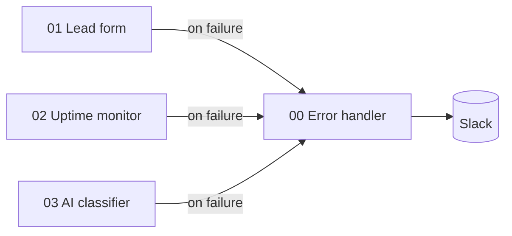

# n8n Automation Demos

  

Four importable [n8n](https://n8n.io) workflows for common business requests.
They are demo projects built for a portfolio, not client work.

| # | Workflow | What it does |
|---|----------|--------------|
| 0 | `00_global_error_handler.json` | Error Trigger → formatted Slack alert (workflow, failed node, error, execution link) with retries. Attach it as the *Error workflow* of the others. [docs](docs/00_global_error_handler.md) |
| 1 | `01_lead_form_to_sheets_slack.json` | Webhook receives a lead form → validates name/email → appends to Google Sheets → posts to Slack → returns 200. Invalid input takes an error branch and returns 400 with the reasons.  [docs](docs/01_lead_form.md) |
| 2 | `02_website_uptime_monitor.json` | Runs every 15 min (or manually) → checks a list of URLs → marks each UP/DOWN (timeouts and DNS failures count as DOWN instead of crashing) → sends one Slack alert if anything is down.  [docs](docs/02_uptime_monitor.md) |
| 3 | `03_ai_message_classifier.json` | Webhook receives text → calls an OpenAI-compatible chat API → returns `category` (sales/support/billing/spam/other), `urgency` and a one-line `summary`. Bad model output and API errors are handled; empty input returns 400.  [docs](docs/03_ai_classifier.md) |

## Setup
1. Run n8n: `npx n8n` or `docker run -it --rm -p 5678:5678 n8nio/n8n`, then open http://localhost:5678
2. **Workflows → Import from File** and pick a JSON from `workflows/`.
3. Replace the placeholders. The repo contains no real secrets:
   - `YOUR_SPREADSHEET_ID` plus a **Google Sheets OAuth2** credential (sheet tab `Leads` with columns `name, email, phone, message, source, receivedAt, valid, errors`)
   - `https://hooks.slack.com/services/YOUR/WEBHOOK/URL` → your Slack Incoming Webhook URL
   - **Header Auth** credential for the LLM: name `Authorization`, value `Bearer <your API key>`
   - Workflow 2: edit the URL list in the **Sites to Check** node.
4. Activate, then test:
```bash
curl -X POST http://localhost:5678/webhook/lead -H 'Content-Type: application/json' \
  -d '{"name":"Dana Cohen","email":"dana@example.com","message":"Need a quote"}'
curl -X POST http://localhost:5678/webhook/classify -H 'Content-Type: application/json' \
  -d '{"text":"I was charged twice this month, please refund ASAP"}'
```

## How these were tested
Tested locally on n8n 1.90.2. All three were imported through the n8n CLI and run end to end:
- Lead form: valid input returned 200 and the Slack message was delivered. Invalid input returned 400 `["name is required","email is invalid"]`.
- Uptime: 2 real sites came back UP, and a non-existent domain was flagged DOWN and triggered the alert. An earlier run crashed on the DNS failure. That was fixed with `onError: continueRegularOutput`, and both runs are visible in the executions screenshot.
- AI classifier: the full request/response path, including the 400 branch, was exercised.

For transparency: during the test, Slack and the LLM API were replaced by a **local mock HTTP server**, and the Google Sheets node was disabled because no real Google account was used. The live versions of those three steps still need your own credentials.

## Quality checks (run locally)
```bash
python3 validate.py   # JSON validity, required fields, unique names, broken links, orphan nodes, placeholder-only credentials, secret scan
node --test tests/    # unit tests for the JavaScript inside every Code node (10 tests)
```
All four files also import cleanly with `n8n import:workflow` (n8n 1.90.2). The error-handler workflow was import- and unit-tested but not fired by a live failure.
A ready GitHub Actions workflow for these checks is in `ci/validate.yml` (copy to `.github/workflows/` to enable).



Screenshots are in `screenshots/`.

---
Author: Liram Mor – QA & Automation Engineer
