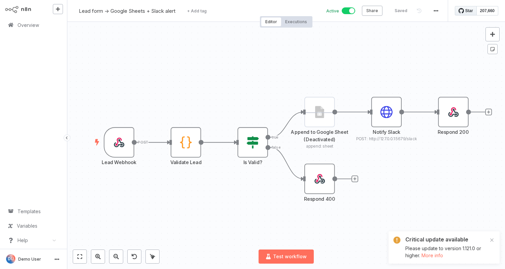

# 01 · Lead Form → Google Sheets + Slack



**Use case:** website/landing-page form posts to a webhook; every lead is validated, stored in a sheet and announced in Slack within seconds.

**Flow:** Webhook → Validate Lead (Code) → Is Valid? → Append to Google Sheet → Notify Slack → 200 · invalid → 400 with reasons

**Error handling:** validation errors are returned to the caller (400 + list); empty bodies don't crash.

**Placeholders:** `YOUR_SPREADSHEET_ID`, Google Sheets OAuth2 credential, Slack webhook URL.

**Test:**
```bash
curl -X POST http://localhost:5678/webhook/lead -H 'Content-Type: application/json' \
  -d '{"name":"Dana Cohen","email":"dana@example.com","message":"Need a quote"}'
```
