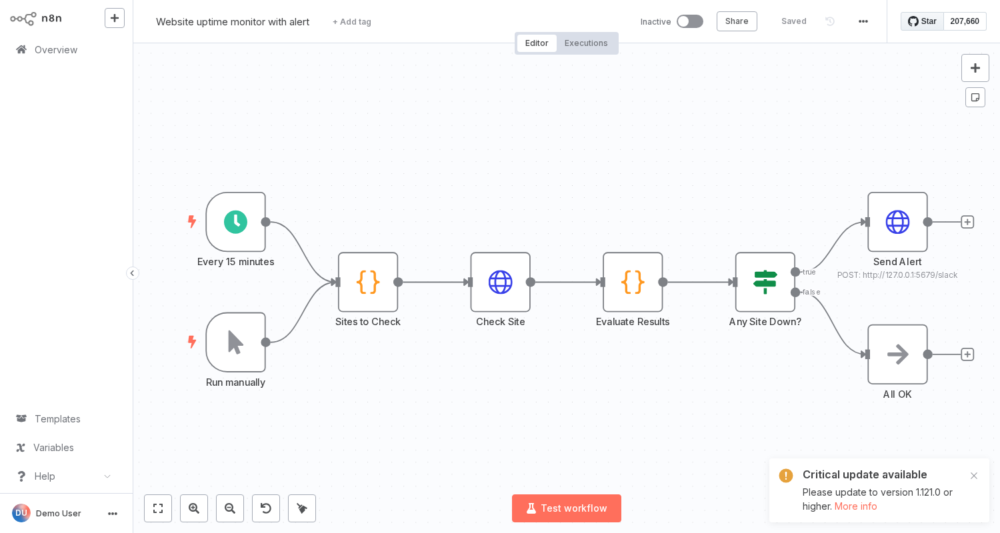

# 02 · Website Uptime Monitor

**Use case:** small businesses/agencies that need to know immediately when a client site goes down, without a paid monitoring tool.

**Flow:** Schedule (15 min) / Manual → Sites to Check → Check Site (HTTP) → Evaluate Results → Any Site Down? → Slack alert

**Error handling:** DNS failures and timeouts are treated as DOWN (`onError: continueRegularOutput`) instead of crashing the run; one combined alert per run.

**Placeholders:** URL list in *Sites to Check*, Slack webhook URL.
