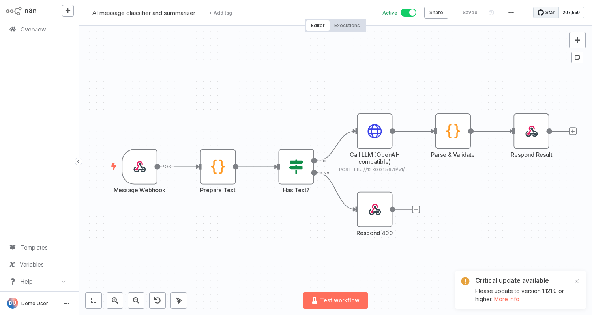

# 03 · AI Message Classifier



**Use case:** route inbound emails/chats/tickets automatically – category (sales/support/billing/spam/other), urgency and a one-line summary.

**Flow:** Webhook → Prepare Text → Has Text? → Call LLM (any OpenAI-compatible API) → Parse & Validate → JSON response · empty → 400

**Error handling:** non-200 API responses, non-JSON model output and unknown categories all return a safe, structured result.

**Placeholders:** Header Auth credential (`Authorization: Bearer <key>`), API URL/model.

**Test:**
```bash
curl -X POST http://localhost:5678/webhook/classify -H 'Content-Type: application/json' \
  -d '{"text":"I was charged twice this month, please refund ASAP"}'
```
